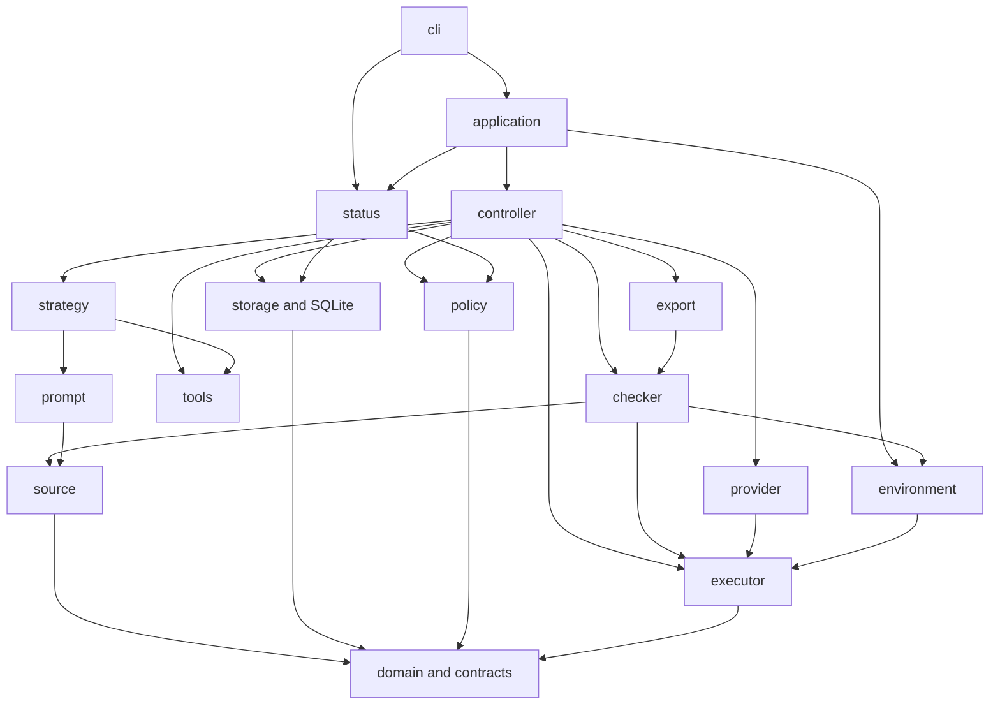

# Midas cleanup blueprint

This proposed architecture gives each rule one owner and routes live, scripted,
and supplied-candidate runs through one execution and acceptance loop. It covers
SQLite, artifacts, environments, Lean checking, probes, retrieval, research,
providers, prompts, proof strategy, export, CLI commands, and status.

The pseudocode defines boundaries to implement incrementally. Component names
describe cohesive ownership areas; they do not require one large Python file per
component. Existing persisted formats, identities, accounting, and verification
contracts remain the starting point. Schema or compatibility changes are separate
work, not an incidental consequence of moving code.

## The overall flow

```text
CLI command
    application prepares or restores frozen inputs
    controller reads a bounded snapshot of committed run state
        strategy proposes work and state changes
        policy decides whether work may be admitted
        storage commits the reservation and exact request
        worker executes one bounded job
        storage records the result and usage
        owning component validates the result against its request
        controller commits accepted effects and downstream work
    status presents committed progress
    export independently verifies the materialized result
```

These are three distinct operations: **plan**, **execute**, and **accept**.
Planning and acceptance use immutable snapshots. Execution receives frozen
requests and read-only inputs. The controller owns write transactions and
scheduling; workers return results without a controller or SQLite connection.

## Component responsibilities

| Component | Owns | Public operations |
| --- | --- | --- |
| `domain` | Shared records, identities, candidate and proof-graph invariants, persisted encodings | Decode, validate, derive identities, propose proof-state changes |
| `policy` | Admission, capacity, budgets, retry eligibility, capabilities, completion classification | Evaluate the same rules for planning, admission, recovery, and display |
| `storage` | SQLite schema and queries, sessions, task ledger, artifact storage and recovery, indexed read views | Read snapshots, stage bytes, commit fenced changes, retain receipts and usage |
| `source` | Lean names, source structure, declaration context, shared source rendering and coordinate mapping | Build source and context values from explicit inputs |
| `executor` | Worker pools, process isolation, cancellation, compiler capacity and retained import workers | Execute bounded work under an existing reservation; report actual termination |
| `environment` | Toolchains, frozen packages, dependency inventories, bindings to source and configuration | Prepare, load, validate, materialize environment inputs |
| `checker` | Inspection, binding checks, proof checks, checked lookup, probes, trusted receipt validation | Prepare compiler requests, execute them, validate their evidence |
| `tools` | Retrieval and research plans, search transport, advisory results, evidence paging | Plan helper stages, perform search, validate helper results |
| `provider` | Backend routing, provider protocols, one model invocation, delivery certainty and usage | Invoke one frozen request; normalize its result |
| `prompt` | Instructions, schemas, mathematical presentation, evidence selection for display, exact wire construction | Render an immutable turn snapshot |
| `strategy` | Candidate generation policy, response interpretation, decomposition, review, repair, objections, memory and continuations | Plan work; reduce validated outcomes into proposed changes |
| `export` | Assembly and integration plans, source/library/LeanEval layouts, independent export verification | Plan stages, render output, verify it, validate stage receipts |
| `controller` | One run loop, admission transactions, dispatch, receipt application, cancellation and recovery coordination | Step, drain, resume, apply external commands |
| `status` | Stable status views, reasons, node queries, terminal and JSON presentation | Read and format; preserve unknown values |
| `application` | Command workflows and construction of concrete services | Start, resume, submit, fork, inspect inputs, package, export, verify |
| `cli` | Arguments, signals, stop IPC, output routing, exit handling | Translate a command into an application call |

The storage component can have private files for schema, queries, ledger, and
artifact segments. The checker can retain separate Lean/C resources and private
compilation helpers. A private split needs a clear responsibility; it should not
require callers to discover and coordinate several fragments of one operation.

## Dependency direction

Arrows below mean permitted component imports. Constructors in `application`
wire concrete instances. Pure records and narrow reader/worker interfaces live
in `domain`, so workers can accept an artifact reader without importing SQLite.
The diagram shows the major edges; the table that follows is exhaustive.



| Component | Allowed component imports |
| --- | --- |
| `domain` | none |
| `policy` | `domain` |
| `storage` | `domain` |
| `source` | `domain` |
| `executor` | `domain` |
| `environment` | `domain`, `source`, `executor` |
| `checker` | `domain`, `source`, `environment`, `executor` |
| `provider` | `domain`, `executor` |
| `tools` | `domain`, `policy`, `source` |
| `prompt` | `domain`, `source` |
| `strategy` | `domain`, `policy`, `prompt`, `tools` |
| `export` | `domain`, `source`, `environment`, `checker` |
| `controller` | `domain`, `policy`, `storage`, `executor`, `strategy`, `provider`, `checker`, `tools`, `export` |
| `status` | `domain`, `policy`, `storage` |
| `application` | `domain`, `policy`, `storage`, `source`, `executor`, `environment`, `checker`, `provider`, `tools`, `prompt`, `strategy`, `export`, `controller`, `status` |
| `cli` | `domain`, `application`, `status` |

`tools` produces descriptions of checker/model jobs; it does not launch those
services. `provider` receives the completed wire request; it does not build
prompts or schedule retries. `storage` accepts explicit changes and expected
versions; it does not import strategy, checker, export, or controller validators.
The controller invokes semantic validators before committing their effects.

The executor may run a supplied callable on a worker. That callable receives
only a frozen request and a restricted worker context, and returns a result.
It cannot invoke controller methods or recursively submit work. A typed,
bounded progress channel supports operations such as committing individual
probe cases; the controller consumes these messages in its event loop.

## Shared records and proof authority

The names below are conceptual types. Large source, wire, and evidence payloads
travel as bounded artifact references instead of copied object graphs.

```python
ArtifactRef = (id, sha256, byte_count)
OwnerVersion = (obligation_id, generation)
Session = (run_id, session_id, epoch)

FrozenRun = record(
    environment_ref, selection_ref, source_ref,
    policy_ref, instruction_refs, provider_routes, workflow_mode,
)

Snapshot = record(
    revision, frozen_run, requested_owners, relevant_proof_frontier,
    selected_candidates, memory_versions, evidence_versions,
    usage, active_reservations, pending_work, finalization_state,
)

Job = record(
    semantic_key, kind, owner_version, depends_on,
    input_refs, expected_versions, resource_requirements,
)
# Kinds include MODEL, CHECK_BINDING, CHECK_PROOF, LOOKUP, PROBE,
# SEARCH, ASSEMBLE, INTEGRATE, EXPORT_VERIFY.

FrozenRequest = record(
    job_id, request_hash, exact_input_refs, owner_version,
    environment_id, expected_versions, limits, operation_payload,
)
Invocation = record(
    original_execution_id, session, frozen_request_ref, reservation,
)
WorkerResult = record(
    invocation_id, request_hash, status, staged_artifacts,
    output, diagnostics, usage, delivery_certainty, termination,
)
Receipt = record(
    original_execution_id, request_ref, result_ref, artifact_refs,
    accounting_identity, outcome, receipt_seal,
)
WorkerContext = record(
    read_only_artifact_reader, environment_handle, private_workspace,
    private_staging, capacity_grant, cancellation, deadline,
    operation_specific_credentials, bounded_progress_channel,
)
ChangeSet = record(
    expected_versions, proof_changes, memory_changes, evidence_changes,
    intent_changes, allowance_changes, retirement_effects,
)
```

`domain` owns structural validation and graph transitions. Checker and export
receipt admission supply the evidence required for trusted transitions. A model
response, helper result, or arbitrary `WorkerResult` cannot establish a proof.

```python
def accept_checked_proof(snapshot, admitted_check):
    require admitted_check.is_bound_to_a_controller_issued_receipt
    require exact_owner_environment_candidate_and_dependency_match(
        snapshot, admitted_check
    )
    if admitted_check.kind == BINDING:
        return record_checked_interface_only(admitted_check)
    if admitted_check.kind == DIRECT_PROOF:
        return select_verified_proof(admitted_check)
    if admitted_check.kind == CONDITIONAL_PROOF:
        require current_review_and_acyclic_dependencies(snapshot, admitted_check)
        return select_conditional_plan(admitted_check)

def retire_plan(snapshot, plan):
    reachable = reachability_after_removing_selected_plan(snapshot, plan)
    return ChangeSet(
        retire=plan,
        fence_only_newly_unreachable_owners=reachable.removed,
        preserve_shared_reachable_work=True,
        cancel_after_commit=reachable.removed,
    )
```

Proof state and export state are separate. A conditional plan needs its children
and checked assembly before it becomes verified. Verified roots still need source
integration and independent export verification for successful run completion.

## Policy

One policy snapshot owns the meaning of attempt budgets, helper budgets, resource
limits, retries, and completion. Its functions consume explicit current usage.
Callers do not recreate counts or hard-code parallel limits.

```python
class Policy:
    def capabilities(self, owner_usage, configured_services):
        return derive_available_modes_and_remaining_budgets(
            self.frozen_rules, owner_usage, configured_services
        )

    def admit(self, job, usage, reservations, capacity):
        # Includes retained compiler-worker memory, backlog and provider gates.
        return Decision(allowed, reason, required_reservation)

    def settle(self, reservation, original_invocation, receipt):
        # Unknown usage remains unknown; duplicate reports are idempotent.
        # Delivery certainty controls which reservations may be refunded.
        return AccountingChange(...)

    def retry(self, saved_request, invocation_history, current_usage):
        # Separate cancellation, transport failure, resource interruption,
        # mathematical rejection, and an uncertain provider delivery.
        # An unknown model outcome requires the existing explicit retry policy.
        return RetryDecision(eligible, reason, charge, earliest_time)

    def completion(self, committed_progress):
        return Completion(
            proof_state, integration_state, export_verification_state,
            outcome, reasons, exit_code,
        )
```

Capability display and actual admission call the same rules. Admission rechecks
usage in the write transaction. Historical instruction and request snapshots
retain their original bytes; a new policy does not rewrite dispatched work.

## SQLite and artifacts

Only `storage` contains application SQL. Domain components receive typed views;
they never receive `db` and never mutate another component's tables directly.
Views are indexed and bounded to the current work, rather than loading the whole
run for every tick. Node inspection remains paginated.

```python
class Storage:
    def create(self, directory, frozen_run):
        require new_directory(directory)
        create_current_schema_and_immutable_run_records(frozen_run)

    def open_reader(self, directory):
        return RunReader(read_only_connection(directory))

    def claim_writer(self, directory):
        lock = acquire_exclusive_run_lock(directory)
        validate_supported_schema_and_storage_integrity()
        session = begin_new_fenced_session()
        return RunWriter(lock, session)

class RunReader:
    def work_snapshot(self, owners, relevant_inputs): return Snapshot(...)
    def status_snapshot(self): return CommittedStatus(...)
    def nodes(self, filters, cursor, limit): return NodePage(...)
    def read_artifact(self, reference, limit): return verified_bounded_bytes(...)

class RunWriter(RunReader):
    def transaction(self, session):
        require_current_process_session_and_epoch(session)
        return Transaction(...)

class Transaction:
    def expect(self, expected_versions): recheck_current_versions(...)
    def reserve(self, request_ref, decision): persist_execution_and_reservation(...)
    def mark_dispatched(self, invocation): persist_before_external_io(...)
    def receive(self, sealed_receipt, usage_change): retain_original_receipt_and_usage(...)
    def apply(self, application_key, changes):
        reject_conflicting_reapplication(application_key, changes)
        apply_all_changes_and_downstream_intents_atomically(changes)
    def finish(self, invocation, disposition): record_application(...)
```

Artifact publication has an explicit boundary with SQLite:

```python
# Worker owns a private staging area, never the shared artifact writer.
staged = worker_context.staging.write_bounded(output_bytes)

# Controller makes immutable bytes durable before publishing references to them.
durable = artifacts.finalize(staged)       # Hash, length, limits and durability.
with writer.transaction(session) as tx:
    tx.register_artifact_metadata(durable)
    tx.receive(receipt_using(durable), usage_change)

# A crash before the transaction may leave unreferenced durable bytes.
# Recovery handles these. A committed receipt must never reference missing bytes.
```

Artifact segments and SQLite are not assumed to share a filesystem transaction.
The storage component owns their publication/recovery protocol. Semantic receipt
and proof validation runs through the owning services during application recovery.

## Source and environment

`source` contains the shared algorithms for Lean names, authored source spans,
declaration context, and generated source. Renderer-specific policies remain
explicit arguments. This prevents probe, candidate, and export paths from
maintaining their own copies of source-handling rules.

```python
class Source:
    def declaration_context(self, selection, checked_bindings): return Context(...)
    def lookup_context(self, selection, requested_checked_aliases):
        return MinimalLookupContext(...)  # Does not decode the whole goal.
    def candidate(self, context, candidate): return GeneratedSource(...)
    def probe(self, context, case): return GeneratedSource(...)
    def integrate(self, original_source, checked_roots, profile): return SourceTree(...)
    def authored_location(self, generated_location, source_map): return LocationOrNone(...)

class Environment:
    def prepare(self, config, executor):
        resolve_pinned_toolchain_project_and_dependencies(config)
        validate_paths_inputs_profiles_and_resource_bounds()
        return publish_frozen_package_and_inventory()

    def restore(self, frozen_environment_ref):
        locate_package_and_toolchain_under_existing_relocation_rules()
        validate_against_saved_manifest_and_admission_policy()
        return EnvironmentHandle(read_only_roots, manifest, toolchain)

    def validate(self, handle, policy): return EnvironmentValidation(...)
    def materialize(self, handle, authorized_inputs, workspace):
        verify_input_hashes_paths_and_no_module_shadowing()
        expose_declared_inputs_and_read_only_roots(workspace)
        return SandboxInputs(...)
```

Keep the current distinction between environment admission policy and exact
generated-input hashes. This design does not silently strengthen or weaken the
toolchain validation contract. Shared caches remain keyed to admitted immutable
inputs; changing an environment invalidates affected cached work.

## Executor and checker

The controller grants capacity once. The executor owns worker lifetimes and
actual OS process termination, including compiler workers retained between jobs.
Checker, probe, lookup, and export compilation consume that same capacity.

```python
class Executor:
    def start(self, invocation, execute, context):
        require context.capacity_grant.matches(invocation)
        launch_one_worker(execute, invocation.frozen_request, context)

    def run_process(self, launch_spec, context):
        require authorized_isolation_profile(launch_spec)
        enforce_remaining_wall_memory_output_and_evidence_limits(context)
        wait_for_actual_process_tree_termination()
        return ProcessResult(...)

    def poll(self): return CompletedWorkers(...)
    def cancel(self, invocation): signal_owned_worker_and_process_tree(...)
    def drain(self): join_workers_and_close_retained_compiler_processes(...)

class Checker:
    def inspect(self, environment, source_ref, selection_request, context):
        return inspect_source_with_the_existing_trusted_input_profile(...)

    def prepare(self, operation, proof_snapshot, environment):
        authorize_exact_bindings_dependencies_and_declared_inputs()
        return FrozenCompilerRequest(...)

    def execute(self, request, context):
        inputs = environment.materialize(
            context.environment, request.authorized_inputs, context.workspace
        )
        result = executor.run_process(lower_to_lean(request, inputs), context)
        return bounded_staged_compiler_output(request, result, context.staging)

    def admit_receipt(self, request, sealed_receipt, acceptance_inputs):
        verify_controller_receipt_and_exact_input_output_bindings()
        validate_identity_dependencies_result_kind_and_required_lean_evidence()
        return AdmittedBindingOrProofOrAdvisoryResult(...)
```

Every compiler caller uses one shared staging, exception normalization, and
publication path. Creating a runner, hitting an artifact cap, cancelling a job,
or crashing produces the same kind of result regardless of the entry point.
Checker-owned source assembly produces explicit build/launch recipes, including
bundled Lean/C hashes. The executor consumes those recipes without importing
checker code to discover its runtime sources.
Unsupported optimized execution follows the current authorized fresh-execution
rules and remaining budget; isolation failure never grants host execution.

Checking and graph acceptance remain distinct: the checker admits exact evidence;
the controller applies the resulting proof changes only against current state.

## Probe retrieval and research

Helpers return job plans and advisory material. They share the controller's task
ledger and do not own a second scheduler, model loop, or retry mechanism.

```python
def plan_helper(action, snapshot, capabilities):
    require action_is_allowed(action, capabilities)
    match action:
        Probe(cases):
            return JobPlan(PROBE(cases, frozen_helper_context(snapshot)))
        Lookup(names):
            return JobPlan(LOOKUP(names, minimal_lookup_context(snapshot, names)))
        Retrieve(query):
            return JobPlan(SEARCH(query), continuation=CHECK_REQUESTED_NAMES)
        Research(question, urls):
            return JobPlan(MODEL(role=RESEARCH, question=question, urls=urls))
        Recall(result_id) | Page(cursor):
            return LocalPlan(read_scoped_saved_evidence, guard_duplicate_delivery)

def execute_search(request, context):
    # Hosted/frozen-source discovery under the existing transport contract.
    return bounded_search_response(request, context)

def continue_helper(plan, admitted_result, snapshot):
    if plan.waits_for_search:
        names = select_candidate_names(admitted_result)
        return JobPlan(LOOKUP(names, minimal_lookup_context(snapshot, names)))
    return EvidenceChange(
        immutable_result=admitted_result,
        scope=snapshot.owner_and_environment,
        authority=ADVISORY,
        continuation=resume_original_strategy_work,
    )
```

The combined retrieval pipeline keeps its original helper charge and records its
stages explicitly; an internal lookup is not a second user request. Compiler
stages still need capacity. Research becomes a normal model job with the saved
research route and bounded web-tool policy. Probes never promote proof state,
and retrieved names are checked before being presented as available interfaces.

A probe batch also preserves the current per-case commit protocol. Completed
cases survive a lost worker, and a started case cannot recover its spent budget
by crashing. Progress messages are bound to an existing invocation and cannot
create new model/compiler work.

```python
# Worker: publish a typed message and wait for a committed acknowledgement.
grant = progress.request(CaseStart(invocation, ordinal, exact_packet_ref))
if grant.saved_completion:
    use_saved_case_result(grant.saved_completion)
else:
    result = run_case_with_residual_limits(case, grant.wall_ms, grant.output_bytes)
    progress.request(CaseComplete(invocation, ordinal, staged_result=result))

# Controller: drain the bounded channel even while the batch worker is waiting.
def apply_probe_progress(message):
    inputs = writer.probe_progress_snapshot(message)
    checked = checker.admit_probe_progress(message, inputs)
    changes, reply = tools.reduce_probe_progress(checked, inputs, policy)
    # Validate exact case/packet, generation, order and residual resource limits.
    durable = artifacts.finalize(message.staged_artifacts)
    with writer.transaction(session) as tx:
        tx.expect(changes.expected_versions)
        tx.register_artifact_metadata(durable)
        tx.apply(message.application_key, changes)
    acknowledge_after_commit(message, reply)
```

Case validation that needs compiler evidence uses `checker` before the tool
reducer. SQL is private to storage. An already completed case returns its saved
result; a lost started case consumes its recorded residual reservation under the
existing policy. Late or repeated progress cannot charge or publish twice.

## Provider and prompt

Prompt construction and provider transport meet at an immutable wire artifact.
The provider has no database, strategy, or prompt-building dependency.

```python
def build_prompt(turn_snapshot, instruction_snapshot, capabilities):
    subject = source.present_subject(turn_snapshot.context)
    evidence = select_and_render_bounded_evidence(turn_snapshot)
    schema = render_saved_role_contract(instruction_snapshot)
    return WireRequest(
        exact_messages=assemble(subject, evidence, schema, capabilities),
        schema=schema,
        renderer_identity=instruction_snapshot.renderer,
        source_bindings=turn_snapshot.exact_versions,
    )

class Provider:
    def invoke(self, frozen_request, context):
        route = frozen_request.saved_route
        transport = select_exact_configured_transport(route)
        result = transport.one_invocation(
            frozen_request.wire_bytes,
            credentials=context.credentials.for_route(route),
            limits=frozen_request.limits,
            cancellation=context.cancellation,
        )
        return normalize_transport_result_and_usage(result)

    def admit_receipt(self, request, receipt, inputs):
        validate_route_request_identity_complete_output_and_delivery_metadata()
        return AdmittedModelOutput(...)  # Still not a mathematical candidate.
```

Prompt rendering performs no I/O and does not read current SQLite state while
building a packet. The controller freezes the exact wire before dispatch.
Provider results preserve raw output, nullable usage, provider IDs, error phase,
and delivery certainty. Retry decisions remain in policy and the controller.
Credentials are supplied only to the relevant worker and are not saved in wire
or request artifacts.

## Strategy

Strategy is a state machine over explicit values. It returns proposed effects
and work; it does not execute SQL, invoke providers, or call the compiler.

```python
class Strategy:
    def plan(self, snapshot, policy):
        process_retirements_and_current_generation_dependencies(snapshot)
        choose_ready_generate_review_repair_or_helper_continuations()
        return ProposedChangesAndJobs(...)

    def prepare_model(self, job, snapshot, policy):
        capabilities = policy.capabilities(snapshot.owner_usage, snapshot.services)
        return prompt.build(snapshot.turn(job), snapshot.instructions(job), capabilities)

    def on_model(self, snapshot, admitted_model_output, dispatched_request):
        action = parse_and_validate_against_dispatched_contract(
            admitted_model_output, dispatched_request
        )
        match action:
            Candidate(value):
                candidate = domain.validate_candidate(value, snapshot.context)
                return retain_candidate_and_request_binding_or_proof_check(candidate)
            Decompose(children, glue):
                return propose_ordered_children_review_and_checked_composition(...)
            Helper(request):
                return tools.plan_helper(request, snapshot, snapshot.capabilities)
            Review(verdict) | Revise(edit) | Object(reason) | Stop(reason):
                return reduce_current_role_action(snapshot, action)

    def on_check(self, snapshot, admitted_check):
        proof_changes = domain.accept_checked_proof(snapshot, admitted_check)
        feedback = derive_feedback_and_attempt_decision(snapshot, admitted_check)
        return combine(proof_changes, feedback, ready_downstream_work(...))
```

Scripted mode supplies saved model responses at the provider boundary. Supplied
candidates enter the same candidate-admission and checking path. Mode-specific
attempt/review rules are explicit policy, while execution, receipt handling,
generation fences, and artifact publication are shared.

## Export

Export planning uses the selected proof graph and exact dependency versions.
Source, library, and LeanEval profiles share lifecycle and resource accounting;
each retains its required layout, build, and audit rules.

```python
class Export:
    def plan(self, snapshot):
        if a_selected_conditional_plan_has_verified_children(snapshot):
            return JobPlan(ASSEMBLE(exact_plan_and_child_validations(snapshot)))
        if roots_are_verified_and_integration_is_missing(snapshot):
            return JobPlan(INTEGRATE(exact_root_validations(snapshot)))
        if current_integration_needs_independent_verification(snapshot):
            return JobPlan(EXPORT_VERIFY(exact_integrated_output(snapshot)))
        return NoNewWork()

    def execute(self, request, context):
        if request.kind == ASSEMBLE:
            return checker.execute(prepare_exact_composition(request), context)
        if request.kind == INTEGRATE:
            tree = source.integrate(request.source, request.roots, request.profile)
            return stage_profile_layout(tree, context.staging)
        if request.kind == EXPORT_VERIFY:
            tree = materialize_exact_export_in_clean_workspace(request, context)
            return clean_rebuild_and_profile_audit(tree, context)

    def admit_receipt(self, request, receipt, inputs):
        validate_exact_profile_files_root_versions_and_required_audit_evidence()
        return AdmittedExportStage(...)

    def on_stage(self, snapshot, admitted_stage):
        require stage_still_matches_selected_roots_and_environment(snapshot)
        return record_stage_and_enable_next_stage(admitted_stage)
```

Independent export verification rebuilds and audits the actual output without
trusting cached native proof artifacts. It does not contact a model provider.
An export failure preserves accepted proofs and permits the appropriate stage
retry. Final materialization publishes the verified files under the existing
destination rules, and records completion only for the current export.

## One controller loop

This is the main implementation seam. Individual operations provide preparation,
execution, receipt admission, and reduction functions. The operation table is
fixed and small; it is not a new plugin framework.

| Operation | Execution owner | Result and effect owner |
| --- | --- | --- |
| Prover, reviewer, scripted response | `provider` | `provider` admits transport; `strategy` interprets the action |
| Research model call | `provider` | `provider` admits transport; `tools` validates advisory research evidence |
| Binding or proof check | `checker` | `checker` admits evidence; `domain` and `strategy` derive changes |
| Probe or checked lookup | `checker` | `checker` admits evidence; `tools` derives advisory delivery |
| Search | `tools` | `tools` validates and plans the next retrieval stage |
| Assembly, integration, export verification | `export` | `export` admits stage evidence; `domain` derives any proof-state change |

```python
class Controller:
    def step(self):
        for message in executor.poll_progress():
            apply_bounded_progress_or_reply_with_rejection(message)

        # 1. Save completed work even if it has become stale for application.
        for completion in executor.poll():
            receipt = seal_and_finalize_worker_result(completion)
            with writer.transaction(session) as tx:
                usage = policy.settle(
                    tx.reservation(receipt), tx.original_invocation(receipt), receipt
                )
                tx.receive(receipt, usage)

        # 2. Validate persisted receipts outside the write transaction.
        for receipt in writer.pending_receipts(limit=receipt_batch):
            inputs = writer.acceptance_snapshot(receipt)
            admitted = admit_receipt_or_bounded_rejection(
                operation(receipt),
                inputs.exact_request, receipt, inputs
            )
            changes = reduce_admitted_result(inputs, admitted)
            try:
                with writer.transaction(session) as tx:
                    tx.expect(changes.expected_versions)
                    tx.require_current_or_explicitly_adopted_receipt(receipt)
                    tx.apply(receipt.application_key, changes)
                    tx.finish(receipt.invocation, changes.disposition)
            except ChangedInputs:
                retain_receipt_for_revalidation_or_historical_disposition(receipt)
            else:
                execute_committed_cancellation_effects(changes)

        # 3. Derive new intents from a bounded view of changed owners/stages.
        view = writer.planning_snapshot(changed_frontier, limit=planning_batch)
        proposed = combine(strategy.plan(view, policy), export.plan(view))
        with writer.transaction(session) as tx:
            tx.expect(proposed.expected_versions)
            tx.apply(proposed.idempotency_key, proposed)

        if stop_requested:
            return  # Continue polling/draining, but admit no new work.

        # 4. Freeze input bytes first, then atomically recheck and reserve.
        for job in writer.ready_jobs(limit=admission_batch):
            snapshot = writer.preparation_snapshot(job)
            request = operation(job).prepare(job, snapshot)
            request_ref = artifacts.publish_immutable(request)
            with writer.transaction(session) as tx:
                tx.expect(request.expected_versions)
                decision = policy.admit(job, tx.usage(), tx.reservations(), capacity)
                if not decision.allowed:
                    tx.record_wait_reason(job, decision.reason)
                    continue
                invocation = tx.reserve(request_ref, decision)

            # Recovery distinguishes PREPARED from DISPATCHED.
            # Mark dispatch durably before any possible external invocation.
            with writer.transaction(session) as tx:
                tx.require_current_and_not_stopping(invocation)
                tx.mark_dispatched(invocation)
            executor.start_or_report_launch_failure(
                invocation, operation(job).execute,
                restricted_worker_context(invocation),
            )

    def run(self):
        while not drained_or_complete():
            step()
            wait_for_completion_stop_or_next_admission_deadline()
        executor.drain()
        return policy.completion(writer.status_snapshot())
```

The omitted operation algorithms live under the owners above. A rejected response
produces a bounded rejection disposition instead of escaping the receipt loop.
Each successful acceptance commits its proof, memory, allowance, and downstream
effects together. Expensive parsing, source rendering, filesystem work, network
calls, and Lean execution happen outside write transactions.

If versions change during preparation, the request is discarded or rebuilt before
reservation. If they change during acceptance, the receipt is revalidated against
current state or retained as history. Neither case repeats external work merely
to obtain the result again. Shared-process capacity and memory reservations are
reconciled with actual worker lifetime, including idle retained compiler workers.

## Recovery stop and fork

Recovery is an application workflow composed from storage integrity checks and
semantic validators. SQLite never calls into higher-level modules during open.

```python
def resume_run(directory, requested_policy_changes):
    writer, session = storage.claim_writer(directory)
    frozen = writer.read_frozen_run()
    env = environment.restore(frozen.environment_ref)
    validate_saved_artifacts_and_domain_records(writer.reader(), env)
    # Validation uses bounded pages/streams and the established cache policy.
    with writer.transaction(session) as tx:
        tx.reconcile_prepared_dispatched_received_and_applied_work()
        tx.apply_explicitly_allowed_policy_changes(requested_policy_changes)
    return build_controller(writer, env, frozen).run()

def request_stop():
    record_stop_in_the_owning_controller()
    stop_new_admissions()
    executor.cancel_owned_work()
    persist_completed_receipts_and_uncertain_delivery_state()
    executor.drain()

def fork_run(parent, fork_request):
    checkpoint = storage.read_consistent_parent_checkpoint(parent)
    selection = domain.validate_fork_selection(checkpoint, fork_request)
    frozen = prepare_fork_environment_guidance_and_lineage(checkpoint, selection)
    child = storage.create_new_run(frozen)
    copy_or_reference_authorized_immutable_artifacts(checkpoint, child)
    import_only_compatible_checked_evidence_under_child_bindings(child)
    record_lineage_and_pending_validation_work(child)
    return child
```

On resume, unstarted prepared work can release its reservation. Dispatched model
work without a receipt retains uncertain delivery and usage; it does not gain a
free retry. Replay-safe compiler/local work follows its recovery policy. Saved
receipts can be explicitly adopted into the new session without a second model
charge, then pass normal acceptance checks. Late results may update original
usage while being ineligible to change current proof state.

Graceful stop does not depend on destroying a Python future as proof that the
underlying process stopped. Remote cancellation retains the transport's actual
certainty. Forking creates a new run with lineage and explicit compatibility
checks; it does not mutate the parent or make ordinary resume reset its budgets.

## Status application and CLI

Status is a read interface. Live display, `inspect`, node queries, and exit
classification use the same projection and reason definitions. Temporary counters
and optimized SQL belong inside storage; the status formatter consumes values.

```python
def read_status(reader, transient_workers=None):
    committed = reader.status_snapshot()
    completion = policy.completion(committed)
    return StatusView(
        committed=committed,
        completion=completion,
        # Optional, explicitly transient details never override committed truth.
        workers=transient_workers,
    )

class Application:
    def execute(self, command):
        match command:
            Targets() | Select() | Preflight():
                return inspect_with_environment_and_checker(command)
            Package():
                return environment.prepare(command.config, executor)
            Start():
                frozen = prepare_environment_selection_policy_and_routes(command)
                writer = storage.create(command.directory, frozen)
                return build_controller(writer, frozen).run()
            Resume():
                return resume_run(command.directory, command.policy_changes)
            Submit():
                return submit_through_current_owner_and_common_candidate_admission(command)
            Fork():
                return fork_run(command.parent, command.request)
            Inspect() | Nodes():
                return status.read_or_query(storage.open_reader(command.directory), command)
            Export() | Verify():
                return run_bounded_model_free_export_command(command)
            Stop():
                return send_stop_request_to_existing_owner(command)

def cli_main(argv):
    command = parse_arguments(argv)
    result = application.execute(command)
    write_selected_json_or_terminal_representation(result)
    return result.exit_code
```

`application` constructs only services required by the command. Inspecting status
does not require credentials, a provider, a compiler, or a write session. Start
and resume share controller construction; scripted mode supplies a deterministic
provider implementation, and supplied-candidate mode enables no model work.
No command bypasses the run lock or writes to an active controller's SQLite
connection. Admission happens through the current owner, or through an exclusively
claimed writer when the command is authorized to open the run itself.

## Ownership decisions that prevent repeated fixes

| Rule or operation | One owner | Consumers |
| --- | --- | --- |
| Candidate identity, shape, dependency and scope rules | `domain` and the shared `source` context algorithms | Supplied, scripted, and live candidates; recovery |
| Attempt/helper allowances and accounting interpretation | `policy` | Controller admission, strategy, recovery, status |
| Exact source/name/span handling | `source` | Checker, probes, lookup, prompts, export |
| Compiler staging and error/result publication | `controller` shared compiler operation | Every compiler entry point |
| Provider delivery and usage normalization | `provider` | All model roles and their receipts |
| Retry eligibility | `policy` | One controller loop |
| Schema, queries, publication ordering and session fences | `storage` | All state readers and controller transactions |
| Candidate and helper continuations | `strategy` and `tools`, returning explicit plans | One controller loop |
| Meaning of verified, integrated, complete and blocked | `domain` records plus `policy.completion` | Controller, status, CLI |

Repeated validation at a trust boundary remains intentional. The same canonical
decoder or rule can be called both at initial admission and during recovery;
removing the second check would change the trust contract. Sharing implementation
does not grant permission to skip validation.

Caches are private accelerators of their owning operation. Preserve bounded
memory, immutable keys, invalidation on relevant versions, fork/thread behavior,
and rejection of transaction-local entries where required. A cache hit does not
replace current owner/generation checks. Status and planning retain indexed,
incremental reads rather than scanning all historical artifacts each tick.

## Mapping the current modules

The table assigns every current Python module one **primary destination**. It is
an ownership map, not an instruction to concatenate files. SQL inside a strategy
or checker module moves to storage; orchestration inside a provider or proof
module moves to the controller. Those responsibilities can split even when the
module has one primary destination below.

| Primary destination | Current modules |
| --- | --- |
| `domain` (11) | `certificate_codec`, `dependency_interfaces`, `formats`, `identity`, `joint_targets`, `persisted`, `proof_state`, `scoped_submission`, `selection`, `serialization_cache`, `submission` |
| `policy` (7) | `export_limits`, `live_config`, `live_limits`, `model_pricing`, `scheduling`, `strategy_allowances`, `strategy_capabilities` |
| `storage` (20) | `artifacts`, `controller_store`, `evidence_archive`, `fork_store`, `helper_store`, `live_store`, `model_store`, `node_store`, `poll_reads`, `probe_store`, `resume_validation`, `retrieval_store`, `script_store`, `staged_artifacts`, `store`, `strategy_driver_store`, `strategy_store`, `submission_store`, `tasks`, `validation_cache` |
| `source` (15) | `assembly`, `candidate_imports`, `checked_binding`, `declaration_context`, `helper_context`, `library_imports`, `lookup_context`, `source_modules`, `source_names`, `source_presentation`, `source_proofs`, `source_statements`, `source_tree`, `strategy_diagnostics`, `strategy_sources` |
| `executor` (6) | `comparator_runtime`, `import_pool`, `import_runtime`, `import_worker`, `lean_runner`, `process_runner` |
| `environment` (12) | `attachment`, `dependency_admission`, `dependency_compiler`, `dependency_modules`, `environment`, `leaneval_admission`, `packaging`, `problem`, `shared_package`, `shared_toolchain`, `toolchains`, `verification_config` |
| `checker` (11) | `cache_probe`, `check_protocol`, `checker_runtime`, `checking`, `extraction`, `interface_lookup`, `probe_runtime`, `proof_execution`, `proof_jobs`, `source_cache`, `source_proof_admission` |
| `provider` (3) | `model_adapters`, `model_protocol`, `model_runtime` |
| `tools` (9) | `combined_retrieval`, `discovery`, `discovery_helpers`, `lookup_helpers`, `lookup_source`, `probe_helpers`, `research_helpers`, `research_protocol`, `retrieval_helpers` |
| `prompt` (10) | `model_evidence`, `model_math`, `prompt_display`, `strategy_context`, `strategy_contract`, `strategy_formats`, `strategy_history`, `strategy_instructions`, `strategy_presentation`, `strategy_prompts` |
| `strategy` (16) | `proof_script`, `strategy_archive`, `strategy_archive_guard`, `strategy_compact`, `strategy_decomposition`, `strategy_driver`, `strategy_evidence`, `strategy_feedback`, `strategy_helpers`, `strategy_input`, `strategy_memory`, `strategy_objections`, `strategy_protocol`, `strategy_repairs`, `strategy_review`, `strategy_runtime` |
| `export` (10) | `comparator`, `export_io`, `finalization`, `finalization_events`, `leaneval_audit`, `leaneval_finalization`, `leaneval_layout`, `leaneval_verify`, `leaneval_workspace`, `portable` |
| `controller` (12) | `controller`, `lean_run`, `live_finalization`, `live_run`, `live_timing`, `pending_checks`, `probe_progress`, `proof_driver`, `script_run`, `strategy_checks`, `strategy_dispatch`, `strategy_lifecycle` |
| `status` (5) | `cli_output`, `live_cli_status`, `live_status`, `node_details`, `nodes` |
| `application` (4) | `forking`, `live_initialization`, `preparation`, `run_cli` |
| `cli` (3) | `__init__`, `__main__`, `cli` |

The nine bundled Lean files remain private checker/source resources, including
the extraction, probe, certificate, and native entry-point templates. The import
worker's C runtime belongs with executor internals. Their assembly and compilation
must retain exact source/version binding; these are not separate application
services.

## Example traces

Each `receive` below durably retains output and original usage. Each `apply`
rechecks versions and commits semantic effects and downstream intents together.

```text
Live direct proof
  strategy plans MODEL → prompt freezes wire → storage reserves and marks dispatch
  → provider invokes → controller receives → strategy parses candidate
  → controller applies candidate and CHECK_PROOF intent
  → checker executes → controller receives → checker admits evidence
  → controller applies verified proof → export stages become eligible

Scripted or supplied proof
  scripted provider supplies its saved response, or application admits a submission
  → same candidate validation → same CHECK_BINDING / CHECK_PROOF operations
  → same receipt and proof acceptance path

Probe
  strategy requests helper → tools plans PROBE → controller reserves compiler work
  → checker runs cases, with controller-committed starts/completions
  → controller receives batch → checker/tools admit advisory evidence
  → controller applies evidence and the original strategy continuation

Retrieval
  tools plans SEARCH → controller reserves one helper request and search work
  → tools searches → controller receives and applies a LOOKUP continuation
  → checker validates requested names → controller receives and applies scoped evidence
  → original strategy work resumes without an extra helper-request charge

Resume after a received result
  application claims new session → storage validates structure and artifacts
  → owning services validate saved semantics → controller adopts original receipt
  → current versions are checked → apply once, with no second provider invocation

Export
  export plans eligible ASSEMBLE → checked composition becomes a verified proof
  → INTEGRATE renders the selected roots → EXPORT_VERIFY rebuilds and audits cleanly
  → controller applies current verification → application publishes verified output
  → status reports the committed proof, integration, and verification states
```

## Implementation order

1. **Settle the interfaces in this blueprint.** Trace one live proof, one scripted
   proof, one probe/retrieval continuation, one resume, and one export through them.
   A trace must name the request, receipt, state owner, and transaction boundary.
2. **Unify compiler execution and publication in the current layout.** Use the
   duplicated `script_run` and `strategy_checks` paths as the first implementation
   of the common operation boundary. Remove the duplicate after both callers use it.
3. **Centralize policy and status meanings.** Make admission, helper capability
   display, recovery checks, and status consume the same definitions.
4. **Make prompts, strategy decisions, and tool plans consume explicit snapshots.**
   Move their direct SQL into bounded storage queries and return proposed changes.
5. **Route all modes through the one controller lifecycle.** Preserve explicit
   policy differences, receipts, stage ordering, and cancellation semantics.
6. **Consolidate source/environment/checker/export ownership.** Share source and
   execution primitives while preserving independent export verification.
7. **Move and merge modules under the settled boundaries.** Remove transitional
   wrappers once their callers migrate; enforce the acyclic import table above.

An old implementation can temporarily sit behind a new interface during migration.
That is a transition mechanism: each slice finishes by removing its duplicated
policy and dead routing code. Renaming the existing dependency tangle behind
facades is not the completion criterion.

For changed behavior, use a focused regression through each affected entry point,
such as the same runner-construction failure in live and scripted modes. Reuse
recorded results for unchanged committed tests. Follow [AGENTS.md](../AGENTS.md)
when selecting reruns; broad discovery, package isolation, integration, and storage
stress are intentional gates only when the changed behavior warrants them.

Existing implementation contracts provide the migration constraints:
[task receipts and accounting](task-ledger.md),
[proof acceptance](proof-checking.md),
[controller](controller.md),
[Lean execution](lean-runner.md),
[source proofs](source-proofs.md), and
[model and strategy runtime](model-runtime.md).
